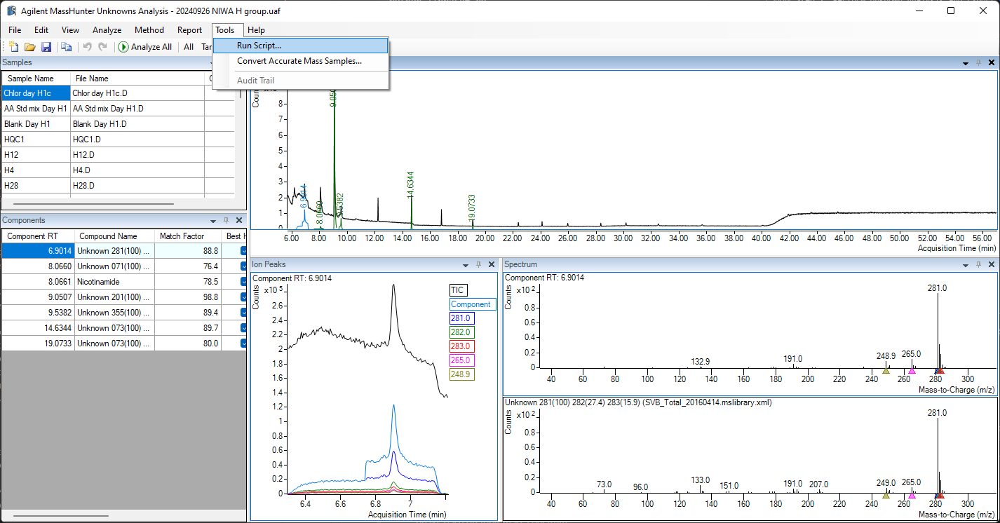
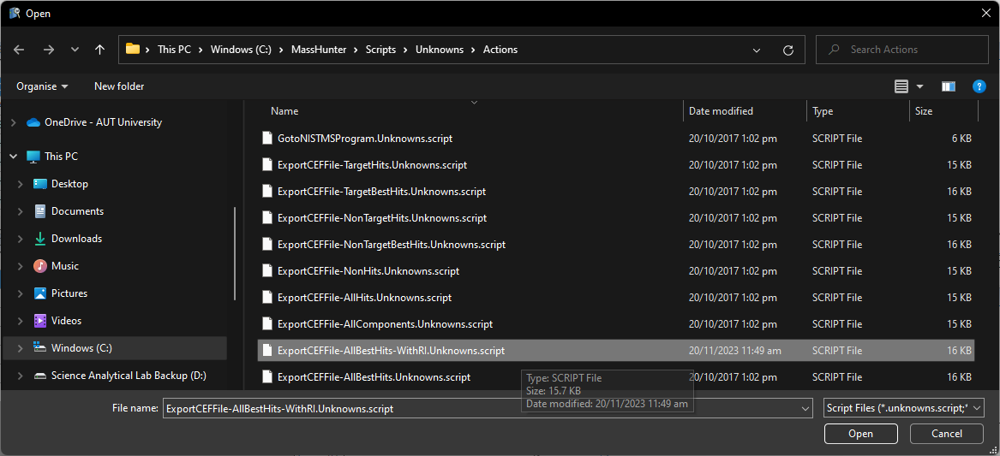
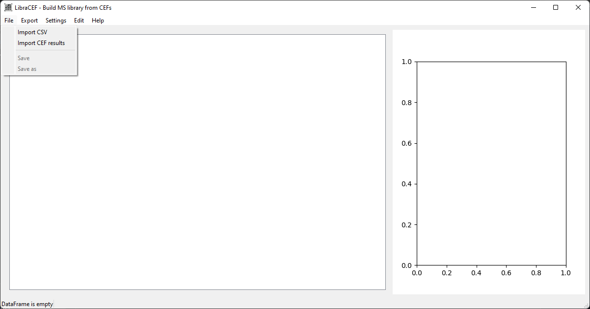
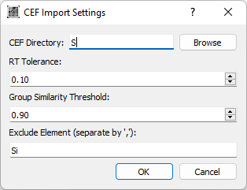
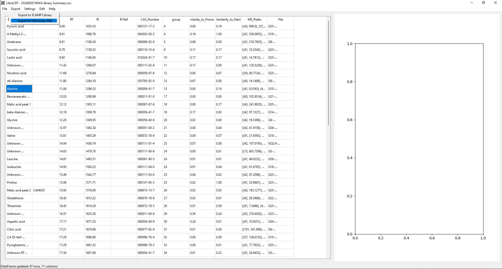

# Libracef: A Tool for Building Agilent Library Files from .cef Files of Mass Hunter Unknown Analysis.

## Introduction
Libracef is a software tool that builds Agilent library files from .cef files of Mass Hunter unknown analysis. This tool is designed to simplify the process of creating library files for use in Agilent's Mass Hunter software.

## Table of Contents

* [Running the Application](#running-the-application)
* [Usage](#usage)
* [Troubleshooting](#troubleshooting)

## Running the Application

### Methond 1: Run using Binary
1. Download the zip file from the releases page. https://github.com/mzzzhunter/libracef/releases

2. Extract the binary to your preferred location.

3. Run the binary using libracef.exe.

### Method 2: Run the python code
1. git clone `https://github.com/mzzzhunter/libracef.git` or download the source code zip files.

1. Install dependencies
```bash
pip install -r requirements.txt 
```

2. Run libracef.py
```bash
python libracef.py
```
## Usage:

### Look up retention indices

Run `python lookup_ri.py 67-56-1` to print JSON containing the mean `WAX`
and `5MS` retention indices from NIST WebBook. Alternatively, call
`from lookup_ri import lookup_ri` and then `lookup_ri("67-56-1")`.

Only temperature-ramp and custom temperature-programme tables are included.
WAX matches column names ending in `-WAX` (such as DB-WAX and TC-WAX), excluding
Carbowax and suffixed variants. 5MS includes only HP-5ms and DB-5ms. Each numeric
RI row has equal weight; missing categories return `""`. Network or page-format
errors raise `LookupRIError`; the command reports errors to stderr and exits
with a nonzero status. Invalid CAS formatting raises `ValueError`.

### To use the application, follow these steps:

1. Copy the `Scripts\ExportCEFFile-AllBestHits-WithRI.Unknowns.script` file to the Mass Hunter Unknown Script folder. e.g. `C:\MassHunter\Scripts\Unkowns\Actions`

2. Perform unkonwn analysis of your samples.

3. Export the Best Hit Results to CEF files by go to menu bar Tools->Run Script. Select `ExportCEFFile-AllBestHits-WithRI.Unknowns.script`.


4. Run `libracef.exe`. 

5. Click File->Import CEF results


6. Browse to select the folder containing the CEF files from step 3. 

>* RT Tolerance: Difference in retention time (in min) to merage the same identification.
>* Group Similarity Threshold: The threshold to group adjacent peaks base on their mass spectrum.
>* Exclude element: Exclude the peak identification that contains the input element. e.g. Si, Cl

>>

7. Curate the compound list table by edit each row if needed by modifying the cells or deleting rows.

   To remove blank contaminants, choose **Actions → Remove Blank Compounds**
   and select one or more blank CEF files. Compounds match by CAS number when
   both entries have one, otherwise by name (ignoring case, surrounding spaces,
   and generated “peak 2” suffixes). Retention time is not required to match.
   The action reports how many rows were removed and can be reversed with Undo.

8. Export to Agilent MSLibrary XML by select Export->Export to MSLibrary XML




### YouTube Tutorial

To learn more about using Libracef, check out our YouTube tutorial:

[Libracef Tutorial: Creating Agilent Library Files from .cef Files](https://youtu.be/fzfVQkmO0Xo?si=tVZp5UxGu2W4Ki65)

[](https://youtu.be/fzfVQkmO0Xo?si=tVZp5UxGu2W4Ki65)

[](https://doi.org/10.5281/zenodo.14791325)

